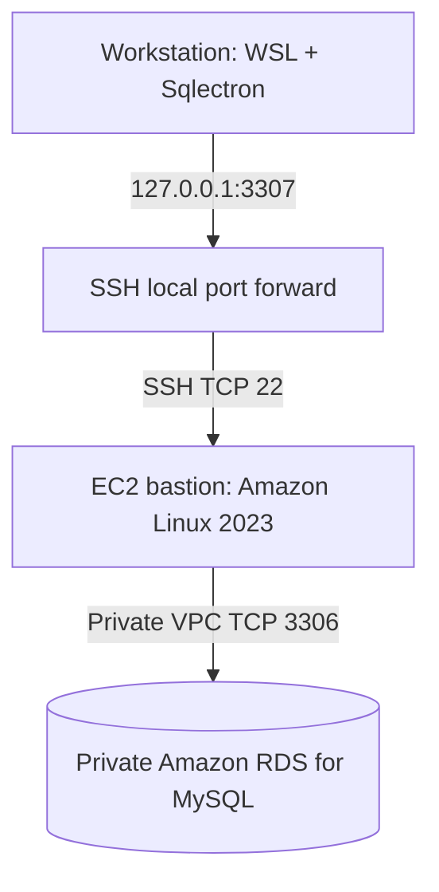
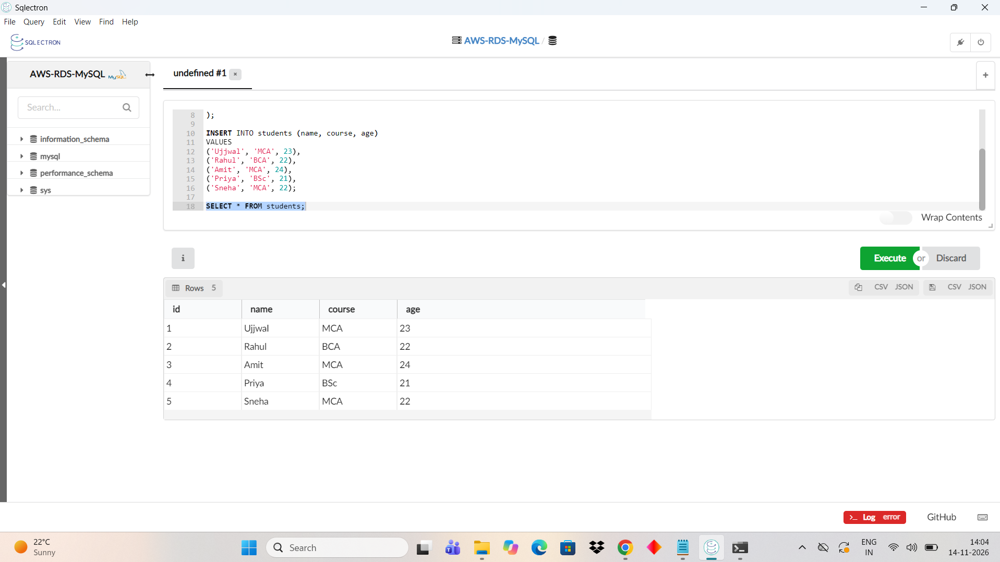
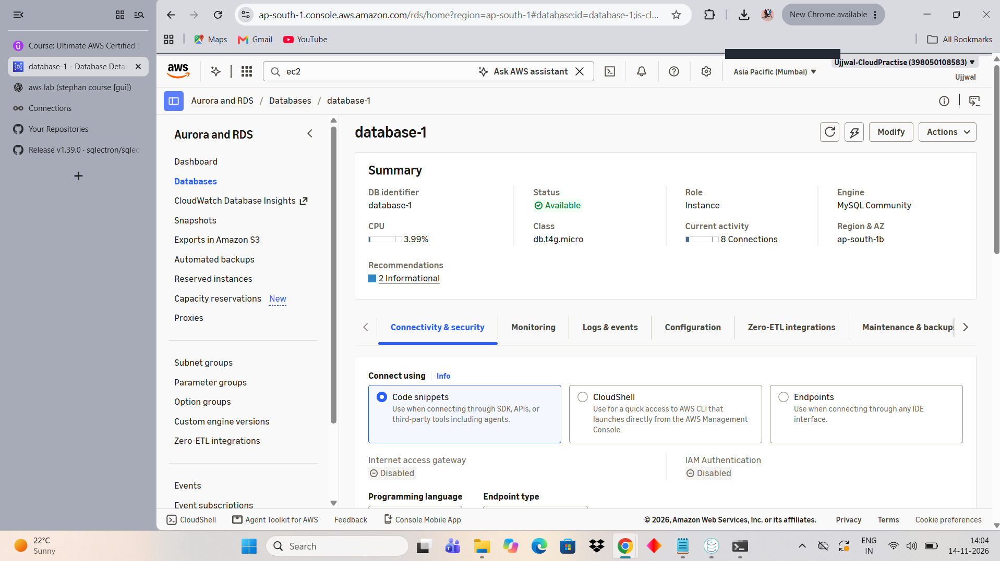
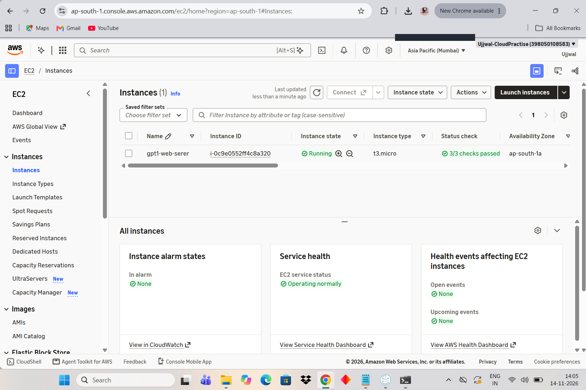
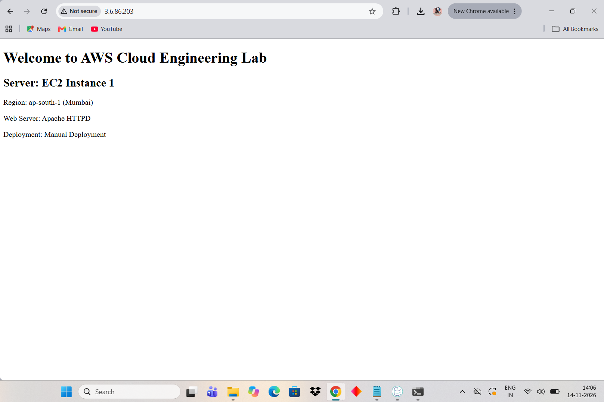
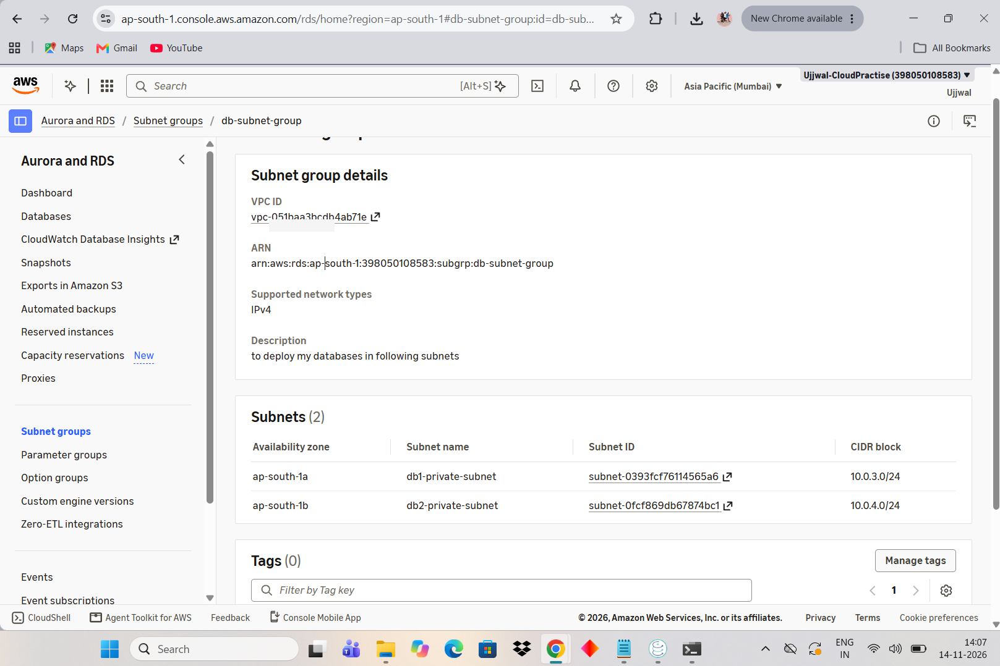
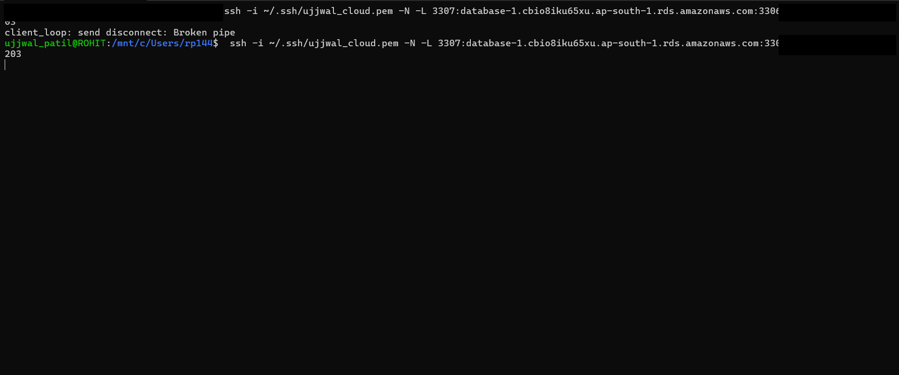
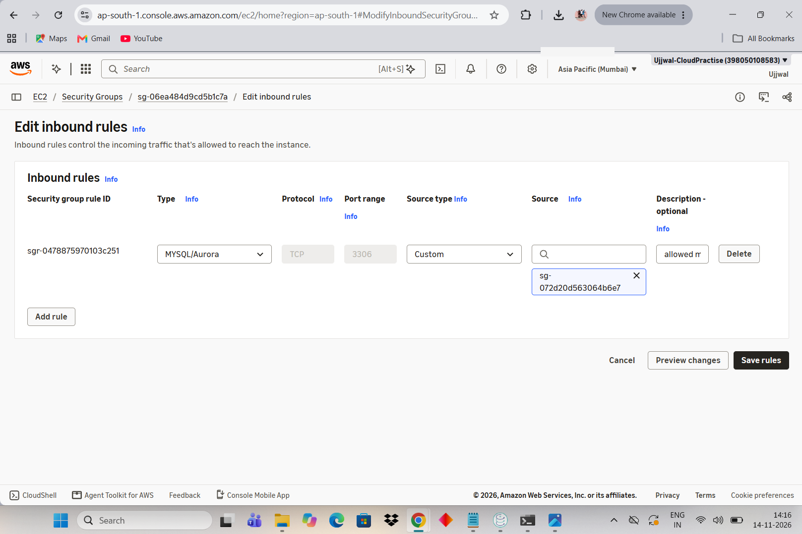

# Private Amazon RDS MySQL Connectivity Through an EC2 Bastion Host

Hands-on AWS lab: connect a local Sqlectron MySQL client to a private Amazon RDS for MySQL database through an EC2 SSH jump host using SSH local port forwarding.

## Lab evidence

The lab session demonstrated an SSH connection from WSL to EC2, EC2-to-RDS TCP reachability on port 3306, local SSH forwarding on 127.0.0.1:3307, and a successful Sqlectron MySQL connection. The MySQL server reported version 8.4.11. The `cloud_lab` database and `students` table were created. Follow-on DML practice is included separately and is not claimed as completed.

## Architecture



## Environment

- AWS Region: `ap-south-1` (Mumbai)
- RDS identifier: `database-1`
- Engine: MySQL; observed version `8.4.11`
- EC2 OS: Amazon Linux 2023; SSH user: `ec2-user`
- Local forwarded port: `3307`; RDS listener: `3306`
- SQL client: Sqlectron
- Created database/table: `cloud_lab` / `students`

Live endpoints, public IPs, account IDs, passwords, and key material are intentionally omitted.

## Security design

- Keep RDS public access disabled.
- Restrict EC2 SSH ingress to a trusted administrator source.
- Restrict RDS inbound MySQL TCP 3306 to the EC2 security group.
- Do not expose port 3306 to `0.0.0.0/0` or `::/0`.
- Never commit `.pem` files, AWS credentials, database passwords, or unredacted screenshots.

**Evidence limitation:** the Security Group screenshot shows the Edit inbound rules page and a MySQL/Aurora TCP 3306 rule with a security-group source. It was captured before saving, so it does not prove that the rule was saved. Verify the final rule in the AWS console.

## Reproduce

1. SSH to EC2 from WSL:

```bash
ssh -i ~/.ssh/<your-key>.pem ec2-user@<EC2_PUBLIC_IP>
```

2. From EC2, verify RDS TCP reachability:

```bash
timeout 5 bash -c '</dev/tcp/<RDS_ENDPOINT>/3306' && echo OK || echo FAILED
```

3. Exit the EC2 shell and start the local tunnel from WSL:

```bash
ssh -i ~/.ssh/<your-key>.pem -N -L 3307:<RDS_ENDPOINT>:3306 ec2-user@<EC2_PUBLIC_IP>
```

Keep the tunnel terminal open. Use a second WSL terminal to test `nc -vz 127.0.0.1 3307`.

4. Configure Sqlectron: MySQL, host `127.0.0.1`, port `3307`, your RDS username/password, and database `cloud_lab` after creating it. Disable Sqlectron's built-in SSH tunnel because WSL handles forwarding separately.

5. Run `SELECT VERSION();` to verify the MySQL session.

## SQL practice

- [`sql/01-create-schema.sql`](sql/01-create-schema.sql): create `cloud_lab` and `students`.
- [`sql/02-crud-practice.sql`](sql/02-crud-practice.sql): sample INSERT, SELECT, UPDATE, DELETE, and aggregation statements. Run deliberately; re-running INSERT creates additional sample rows.

## Screenshots

| Evidence | Screenshot |
|---|---|
| Sqlectron MySQL query results |  |
| RDS database overview |  |
| EC2 instance status |  |
| Apache web server test |  |
| Private DB subnet group |  |
| SSH tunnel |  |
| Security Group edit page (save not verified) |  |

See [`screenshots/README.md`](screenshots/README.md), [`docs/troubleshooting.md`](docs/troubleshooting.md), and [`docs/security-and-cleanup.md`](docs/security-and-cleanup.md).

## Cost cleanup

Disconnect Sqlectron, stop the SSH tunnel, and stop EC2/RDS when not needed. Stopped RDS still incurs storage and some backup-related charges, and stopped DB instances automatically restart after at most seven days. Check Billing for remaining resources. Delete resources only when no longer needed and after preserving required data/snapshots.

## Repository layout

```text
architecture/architecture.mmd
docs/linkedin-post-draft.md
docs/security-and-cleanup.md
docs/troubleshooting.md
screenshots/01-...png through 07-...png
sql/01-create-schema.sql
sql/02-crud-practice.sql
```

## Author

Ujjwal Patil — AWS and Cloud Engineering hands-on learning portfolio.
